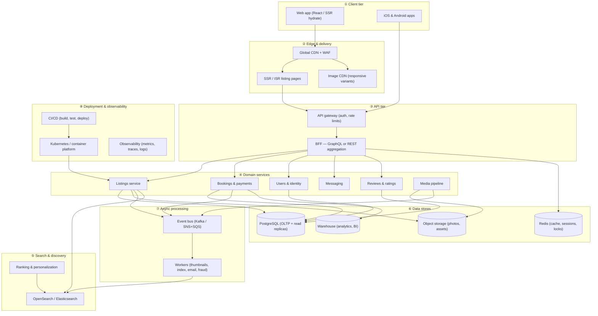

# Architecture

This document satisfies the take-home requirement for a **production-scale vacation rental marketplace** architecture diagram, and documents how the **submitted demo** maps to that model.

**Reference implementation (this repo):** single-listing clone — React SPA, read-only Express API, static JSON fixture, Vercel hosting.

---

## Figure 1 — Production marketplace (submit this PNG)

**File:** [`architecture-diagram.png`](./architecture-diagram.png)  
**Source:** [`diagrams/marketplace-production.mmd`](./diagrams/marketplace-production.mmd)

Eight tiers show how an Airbnb-scale product scales:

| Tier | Role | Scaling lever |
|------|------|----------------|
| ① Client | Web + mobile | CDN-cached assets; code-split routes; native apps hit gateway directly |
| ② Edge | CDN, SSR/ISR, image CDN | Global PoPs; cache listing HTML; resize photos at edge |
| ③ API | Gateway + BFF | Rate limits, auth; aggregate listing + booking + user in one round-trip |
| ④ Domain services | Listings, bookings, users, messaging, reviews, media | Horizontal pods; stateless; DB per bounded context |
| ⑤ Search | OpenSearch + ranking | Sharded index; async refresh from listing events |
| ⑥ Data | PostgreSQL, Redis, S3, warehouse | Read replicas; cache hot listing; objects immutable in S3 |
| ⑦ Async | Event bus + workers | Decouple uploads, search indexing, notifications, anti-fraud |
| ⑧ Platform | K8s, CI/CD, observability | Blue/green deploys; SLOs on gateway and booking path |



*(Diagram matches `diagrams/marketplace-production.mmd`; regenerate PNG after edits.)*

---

## Figure 2 — This take-home demo (context)

**File:** [`architecture-demo.png`](./architecture-demo.png) (optional in zip)  
**Source:** [`diagrams/demo-app.mmd`](./diagrams/demo-app.mmd)

The assignment clone intentionally implements a **thin slice** of tier ① + a minimal read API:

- **Frontend:** `apps/web` — listing page, photo tour, lightbox; overlay state synced to URL query params.
- **Backend:** `apps/api` — `GET /api/listing`, `GET /api/health`; data from `fixtures/listing.json`.
- **Deploy:** Vercel — static SPA + `api/index.ts` serverless handler; fixture bundled via `vercel.json` `includeFiles`.

Production tiers ⑤–⑧ are **out of scope** for the demo but shown in Figure 1 as the target scale.

---

## Regenerate exports (before zipping)

From repository root:

```bash
npx --yes @mermaid-js/mermaid-cli -i docs/diagrams/marketplace-production.mmd -o docs/architecture-diagram.png -b white -s 2
npx --yes @mermaid-js/mermaid-cli -i docs/diagrams/demo-app.mmd -o docs/architecture-demo.png -b white -s 2
```

**Submission zip:** include at minimum **`docs/architecture-diagram.png`** (Figure 1). Optionally add `architecture-demo.png` and this markdown file.

---

## Design notes (short)

- **Read path:** CDN → SSR listing shell → BFF loads listing + calendar + host from services; Redis caches hot listing IDs.
- **Write path:** Booking service owns transactions in PostgreSQL; emits events for receipt email and analytics warehouse.
- **Search path:** Listing changes → bus → worker updates OpenSearch; mobile/web search hits ES, not primary DB.
- **Media path:** Upload to S3 → worker generates sizes → image CDN serves `srcset` URLs stored on listing records.

These patterns mirror how large marketplaces keep the listing **read-heavy** path fast while isolating **booking** and **search** growth.
